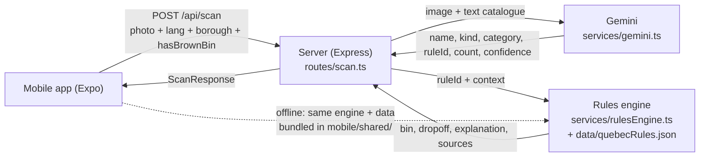

# TriMTL

**Mission.** Montrealers sort waste wrong because the rules are surprising (drink cans go back for the
deposit, chip bags go in the recycling since 2025, yard waste depends on your borough). TriMTL turns a
photo of your trash into a short sorting game. Gemini recognises the objects, and a rules engine built
from montreal.ca decides each bin. Every answer links to its official source, and anything we're not
sure about is labelled "Needs verification" instead of guessed. Built in 24 h for the App|ETS Mobile
Challenge.

## Architecture



The one rule that keeps answers trustworthy: **Gemini never chooses a bin.** It only says what each
object is (`category`) and which catalogue entry it matches (`ruleId`). The rules engine is the only code
that decides `correctBin`. If nothing matches, the item says "Needs verification" and the app asks the
user. See [docs/DECISIONS.md](docs/DECISIONS.md) for why.

## The four bins

| Bin | Means |
|---|---|
| `recycling` | Blue or green recycling bin. Since 2025, *all* packaging, wrappers and coffee cups included. |
| `compost` | Brown bin (food scraps, soiled paper; yard waste too in the 5 "combined" boroughs). |
| `garbage` | Household garbage. |
| `special` | Not a curbside bin. **`dropoff`** says where it goes: `deposit` (consigne), `ecocentre`, `pharmacy`, `donation`, `tree_collection`, `bulky_collection`, `yard_collection`. `dropoffName` is that place's name in the user's language. |

The game has four bins so it stays playable. The real destination for `special` items is the dropoff,
which the results screen shows.

## Run it

**Server** (Node ≥ 20.6):

```bash
cd server
npm install
cp .env.example .env        # paste GEMINI_API_KEY from aistudio.google.com -> Get API key
npm run dev                 # prints http://<your-LAN-IP>:3001 : that is the URL the phone uses
curl http://localhost:3001/health
```

**App on a phone with Expo Go** (once `mobile/` exists):

```bash
cd mobile
npm install
npx expo start              # scan the QR code with Expo Go
```

- Phone and laptop on the **same Wi-Fi**, and the app's API URL set to `http://<laptop-LAN-IP>:3001`.
- Campus/event Wi-Fi and phone hotspots often block device-to-device traffic. If `/health` doesn't load
  in the phone's browser, use a tunnel: `npx cloudflared tunnel --url http://localhost:3001` (HTTPS URL),
  or `npx expo start --tunnel` for the app itself.
- For the demo, deploy the server on a public HTTPS URL. Don't rely on venue Wi-Fi.

### Environment variables (server/.env only)

| Variable | Required | Default | Notes |
|---|---|---|---|
| `GEMINI_API_KEY` | yes | none | **Only in `server/.env`** (git-ignored). Never in `mobile/`, never in a commit, never in logs. Without it `/api/scan` returns `500 no_key`. |
| `GEMINI_MODEL` | no | `gemini-3.1-flash-lite` | 2–4 s per photo in testing. |
| `PORT` | no | `3001` | |

## Checks

```bash
cd server && npm run check
```

This runs, in order, and fails on the first error:

1. `tsc --noEmit` (strict). Also catches drift between `types.ts` and its Zod mirror `schemas.ts`.
2. `validate-rules`: loads `quebecRules.json` through Zod and the integrity checks, and lists unverified rules and overrides.
3. Unit and route tests (`node:test` + `tsx`). Gemini is mocked, so no key and no network are needed.
4. `lint-docs`: every source file has an owner header and every export has JSDoc.
5. `check-shared`: the copies in `mobile/shared/` are byte-identical to the server's. It's skipped until `mobile/shared/` exists.
6. `check-secrets`: no API key in any tracked or new file, and none mentioned in `mobile/`.

After changing `types.ts`, `rulesEngine.ts` or `quebecRules.json`, run `npm run sync-shared`.

## Repo layout and owners

```
server/
  src/
    index.ts                 Express app, /health, error handler                 Juan
    routes/scan.ts           POST /api/scan                                       Juan
    services/gemini.ts       Gemini call, prompt, schema, retry                   Juan
    services/rulesEngine.ts  Pure rules engine: the ONLY bin decider              Waddah
    services/sortingRules.ts Loads quebecRules.json into the engine (server)      Waddah
    data/quebecRules.json    Verified Montréal rules, boroughs, dropoffs          Waddah
    routes/classify.ts       POST /api/classify (user corrects a name)            Waddah
    routes/score.ts          POST /api/score                                      Waddah
    services/scoring.ts      Score out of 100                                     Waddah
    services/sessions.ts     In-memory scan sessions                              Waddah
    types.ts                 Shared API contract                                  Juan + Waddah
    schemas.ts               Zod mirror of the contract (tests)                   Juan + Waddah
    tests/                   node:test suites + fixtures
  scripts/                   check, sync-shared, docs and secrets lint            Waddah
mobile/                      Expo app: UI (Melik), game and AI UI (Zayaan)
  shared/                    COPIES of types.ts, rulesEngine.ts, quebecRules.json (offline). Don't edit.
docs/
  API.md                     Endpoints, request/response JSON, errors
  RULES.md                   Rules JSON schema, how to add items/overrides, verified facts
  DECISIONS.md               Why the architecture is the way it is
```

| Area | Owner |
|---|---|
| Gemini, scan route, Express app | Juan |
| Rules data, engine, scoring, sessions, offline copies | Waddah |
| App UI | Melik |
| Game screens and AI UI | Zayaan |

## Contributing

- Contracts (`types.ts`, response JSON) change **additively only**: add fields, never rename or remove them. See [docs/API.md](docs/API.md#contract-changes).
- Rule data changes need a montreal.ca `sourceUrl` and `verified: false` until someone has checked it. See [docs/RULES.md](docs/RULES.md).
- Open PRs against `main`; the PR template has the checklist.
